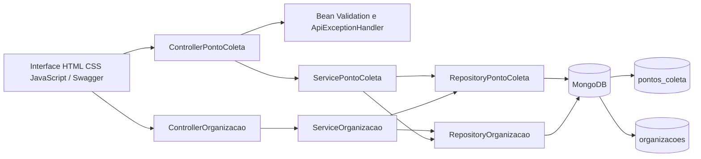
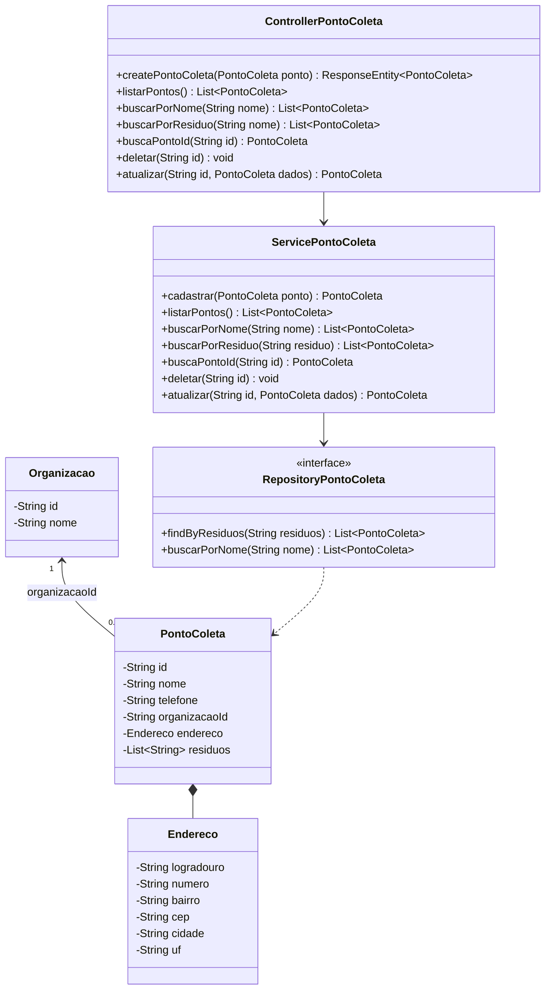
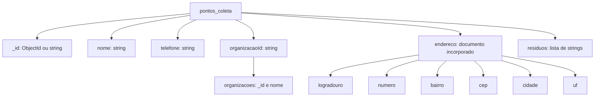

# Diagramas do EcoDescarte

Este documento registra a arquitetura atual da Prova de Conceito. Os diagramas acompanham o código existente e devem ser atualizados quando a estrutura do backend mudar.

## Arquitetura em camadas

Os Controllers recebem HTTP e validam os dados. Os Services organizam os casos de uso e verificam os vínculos; os Repositories persistem nas coleções `pontos_coleta` e `organizacoes` do MongoDB.

O frontend é servido pelo próprio Spring Boot. O Controller valida os dados de entrada, e `ApiExceptionHandler` devolve erros em JSON com status 400, 404 ou 503. `DadosIniciaisConfiguration` insere três registros fictícios ausentes na inicialização; essa carga pode ser desativada por configuração.

## Diagrama de classes

## Modelo do documento MongoDB

O endereço é incorporado ao documento do ponto de coleta. Portanto, não existe uma coleção separada para endereços ou resíduos nesta etapa da PoC.

A organização é armazenada separadamente porque pode responder por vários pontos. O vínculo é obrigatório nos novos cadastros e atualizações, verificado pela API e indexado em `pontos_coleta.organizacaoId`. O endereço incorporado é o objeto complexo exigido pelo enunciado. A API impede excluir organizações com pontos vinculados (409); não há exclusão em cascata. As verificações entre coleções não são transacionais: a PoC demonstra uso local sequencial, sem garantir integridade sob gravações diretas ou concorrentes no banco.

Na API, o identificador é exposto como `id` (string). Cadastros novos recebem um ObjectId gerado pelo MongoDB; os três exemplos iniciais usam strings fixas para permitir a carga repetida sem duplicação. Todos os documentos mantêm a mesma estrutura de negócio.
